<div align="center">
  <h1>Lingji | 灵机</h1>
  <p><strong>多模态检索增强的智能教学助手平台</strong></p>
  
  <a href="LICENSE"></a>
  
  
  

  <p>
    <a href="#-核心特性">核心特性</a> •
    <a href="#-系统演示">系统演示</a> •
    <a href="#-架构设计">架构</a> •
    <a href="#-快速开始">快速开始</a> •
    <a href="#-功能模块">功能</a>
  </p>
</div>

---

## 🌟 项目简介

**Lingji（灵机）** 是一个基于 [RAGFlow-Plus](https://github.com/zstar1003/ragflow-plus) 深度定制的**多模态检索增强生成（Multimodal RAG）**教学平台。通过**页面级图文检索** + **视觉语言模型（VLM）**回答，实现了对课件、文档、视频等教学资源的智能化理解与问答。

#### 1️⃣ **多模态 RAG 引擎**
- 📄 **页面级检索**：保留文档原始页面结构，图文并茂地检索与展示
- 🖼️ **视觉理解**：集成 Qwen3-VL 系列模型，直接理解图表、公式、截图等视觉内容
- 🔍 **混合检索**：结合文本语义检索 + 视觉特征检索 + 重排序，提升准确率

#### 2️⃣ **教育场景深度适配**
- 👨‍🏫 **教师端**：班级管理、助教配置、教学进度追踪、学生行为分析
- 👨‍🎓 **学生端**：AI 对话答疑、课件学习、思维导图、闪卡速记、视频学习
- 📊 **数据看板**：实时统计学习时长、对话轮次、知识库使用情况

#### 3️⃣ **文档解析增强**
- 🚀 使用 **MinerU** 替代传统 OCR，支持复杂排版、表格、公式的精准解析
- 📑 支持 PDF、Word、PPT、视频等多种格式
- 🎨 保留原始页面图片，支持图文混排输出

#### 4️⃣ **灵活的部署架构**
- 🐳 **Docker 一键部署**，开箱即用
- 🔌 **模块化设计**：前台（React）、后台（Vue3）、API（Flask）、微服务（Qwen3-VL、MinerU）
- ☁️ 支持本地部署和云端部署

---

## 📸 系统演示

### 学生端界面

<table>
  <tr>
    <td width="50%">
      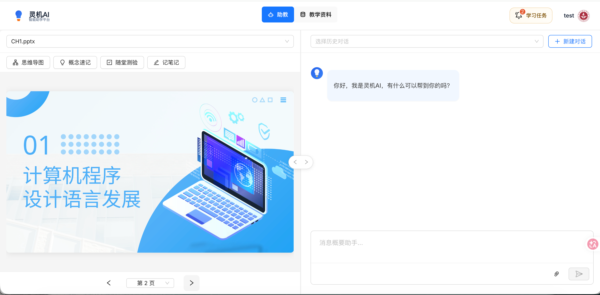
      <p align="center"><b>系统主页面</b></p>
    </td>
    <td width="50%">
      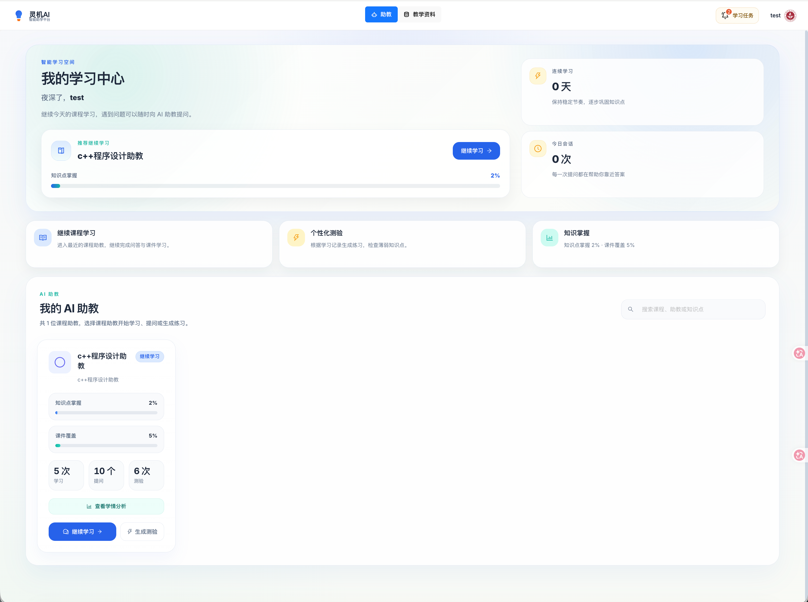
      <p align="center"><b>AI 助教对话</b></p>
    </td>
  </tr>
  <tr>
    <td width="50%">
      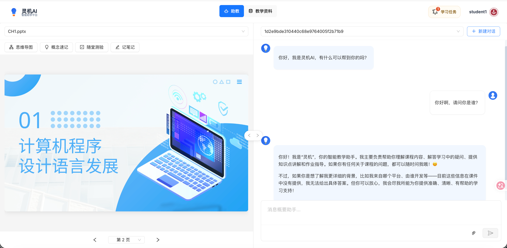
      <p align="center"><b>智能问答界面</b></p>
    </td>
    <td width="50%">
      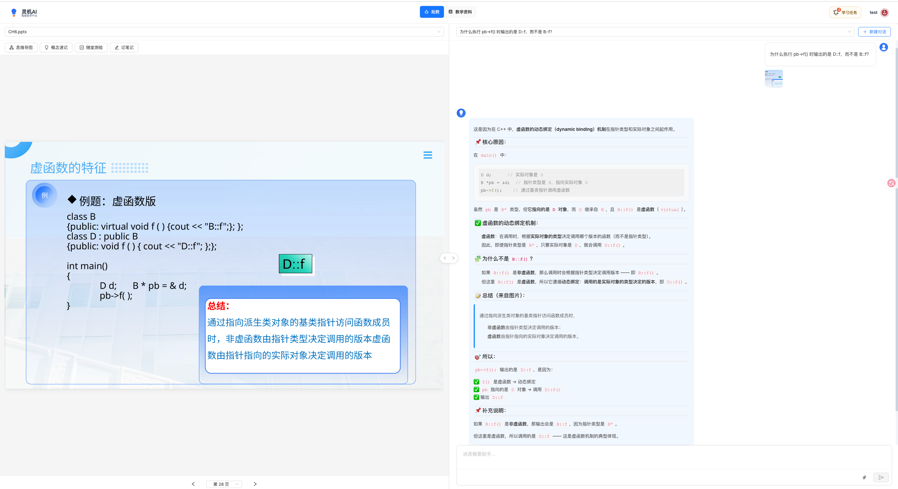
      <p align="center"><b>多轮对话</b></p>
    </td>
  </tr>
</table>

### 多模态图文理解

<table>
  <tr>
    <td width="50%">
      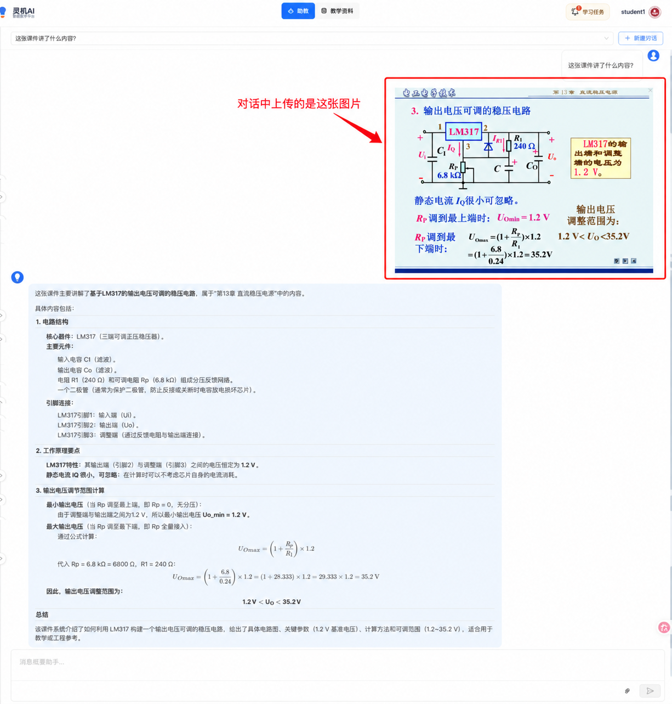
      <p align="center"><b>图片上传提问</b></p>
    </td>
    <td width="50%">
      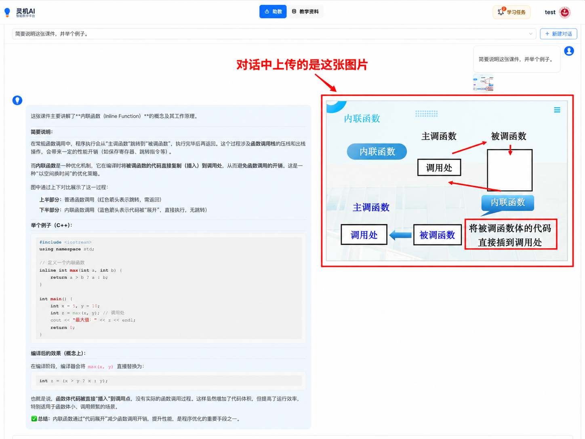
      <p align="center"><b>图文混合输出</b></p>
    </td>
  </tr>
</table>

### 教师管理后台

<table>
  <tr>
    <td width="50%">
      
      <p align="center"><b>数据概览看板</b></p>
    </td>
    <td width="50%">
      
      <p align="center"><b>学情分析</b></p>
    </td>
  </tr>
  <tr>
    <td width="50%">
      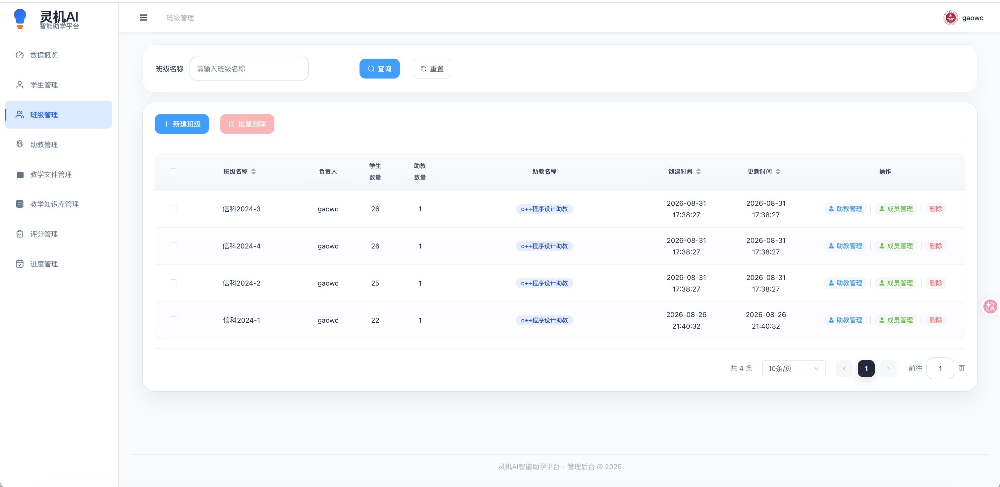
      <p align="center"><b>班级管理</b></p>
    </td>
    <td width="50%">
      
      <p align="center"><b>学生管理</b></p>
    </td>
  </tr>
  <tr>
    <td width="50%">
      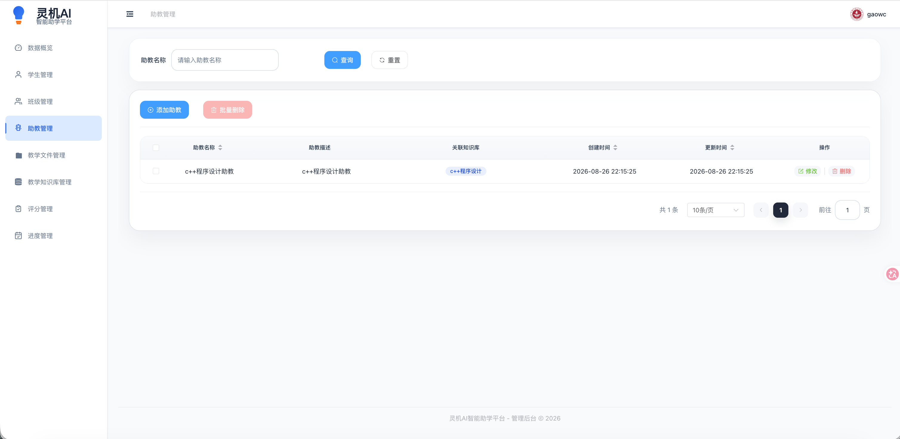
      <p align="center"><b>助教配置</b></p>
    </td>
    <td width="50%">
      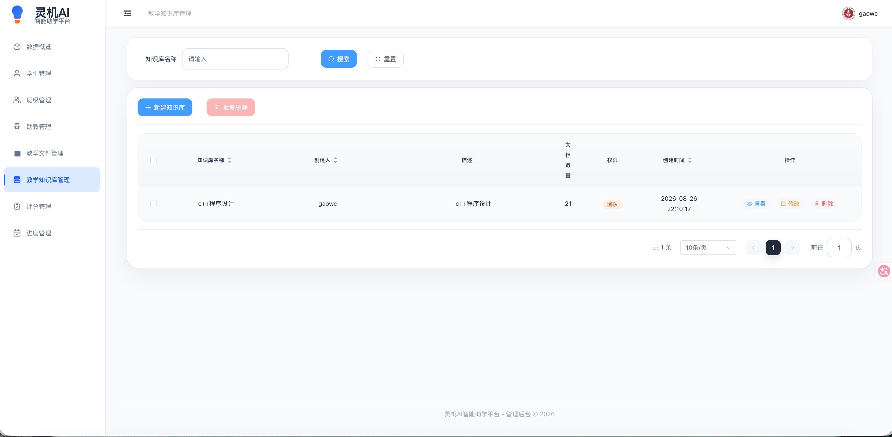
      <p align="center"><b>知识库管理</b></p>
    </td>
  </tr>
  <tr>
    <td width="50%">
      
      <p align="center"><b>教学进度管理</b></p>
    </td>
    <td width="50%">
      
      <p align="center"><b>评分管理</b></p>
    </td>
  </tr>
</table>

---

## 🏗️ 架构设计

### 系统架构图

<div align="center">
  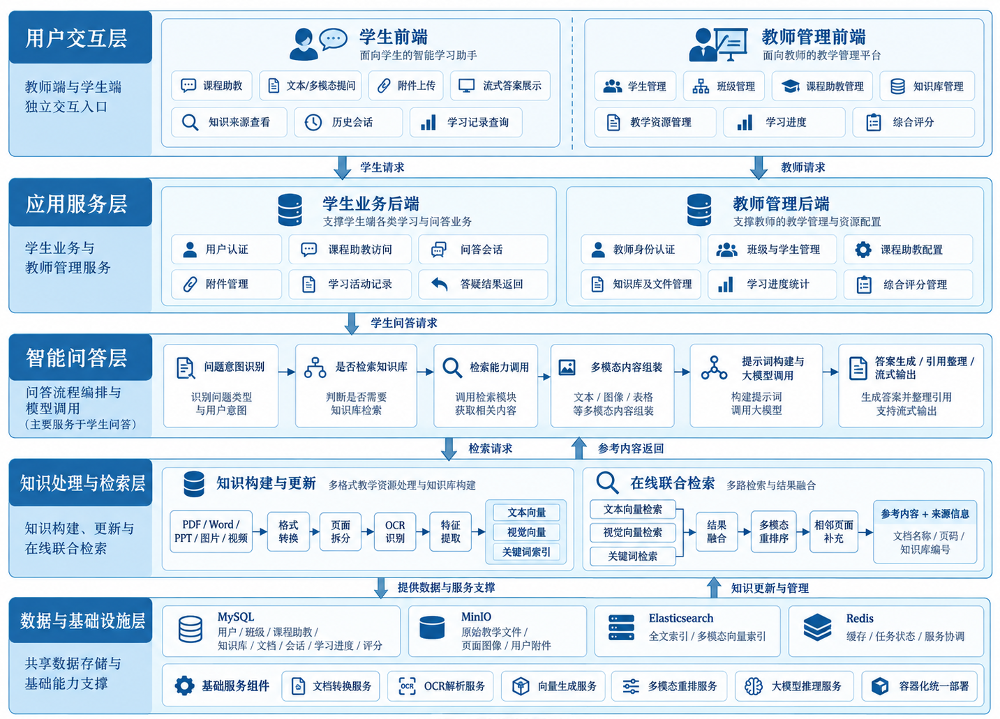
  <p><i>灵机多模态 RAG 系统架构</i></p>
</div>

### 业务流程

<table>
  <tr>
    <td width="50%">
      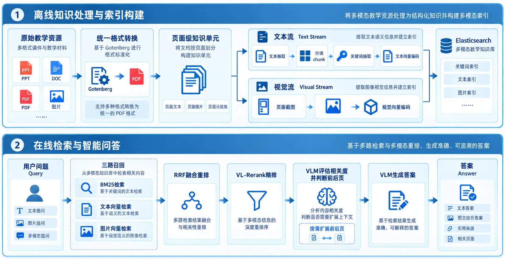
      <p align="center"><b>整体业务流程</b></p>
    </td>
    <td width="50%">
      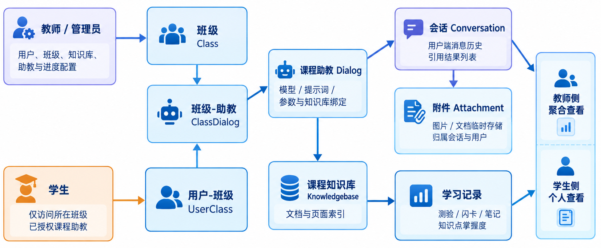
      <p align="center"><b>角色权限关系</b></p>
    </td>
  </tr>
</table>

### 技术架构

```
┌─────────────────────────────────────────────────────────────────┐
│  📱 前台系统 (学生 & 教师)                                        │
│  ┌────────────────────┐    ┌────────────────────────────────┐   │
│  │ Web (React + Umi)  │    │ API (Flask :9380)              │   │
│  │ - AI 对话答疑       │───▶│ - 对话管理 /v1/dialog/*         │   │
│  │ - 课件学习          │    │ - 知识库 /v1/kb/*               │   │
│  │ - 视频学习          │    │ - 文档解析 /v1/document/*       │   │
│  │ - 思维导图 & 闪卡   │    │ - 教学进度 /v1/progress/*       │   │
│  └────────────────────┘    └────────────────────────────────┘   │
├─────────────────────────────────────────────────────────────────┤
│  ⚙️ 后台管理系统 (教师专用)                                       │
│  ┌────────────────────────┐  ┌─────────────────────────────┐   │
│  │ Web (Vue3 + Element)   │  │ Management API (Flask :5000) │   │
│  │ - 学生 & 班级管理       │─▶│ - 用户管理 /api/v1/users/*   │   │
│  │ - 助教配置              │  │ - 班级管理 /api/v1/teams/*   │   │
│  │ - 教学文件管理          │  │ - 助教管理 /api/v1/assistants│   │
│  │ - 数据看板 (ECharts)    │  │ - 数据统计 /api/v1/dashboard │   │
│  └────────────────────────┘  └─────────────────────────────┘   │
├─────────────────────────────────────────────────────────────────┤
│  🧠 AI & 存储基础设施                                             │
│  ┌──────────────┐  ┌──────────────┐  ┌──────────────────────┐  │
│  │ Qwen3-VL     │  │ MinerU       │  │ MySQL + Redis        │  │
│  │ Embedding &  │  │ OCR Service  │  │ MinIO + Elasticsearch│  │
│  │ Reranker     │  │ :6060        │  │                      │  │
│  └──────────────┘  └──────────────┘  └──────────────────────┘  │
└─────────────────────────────────────────────────────────────────┘
```

---

## 🚀 快速开始

### 前置要求

- **Docker** 20.10+ 和 **Docker Compose** 2.0+
- **GPU**（推荐）：用于运行 Qwen3-VL 模型（至少 8GB 显存）
- **内存**：建议 16GB+

### 一键部署

```bash
# 1. 克隆仓库
git clone https://github.com/<your-username>/lingji.git
cd lingji

# 2. 配置环境变量（重要！）
cp conf/service_conf.yaml.example conf/service_conf.yaml
# 编辑 conf/service_conf.yaml，配置数据库密码、API Key 等

# 3. 启动所有服务
docker compose -f docker/docker-compose.yml up -d

# 4. 等待服务启动（首次启动需要下载模型，约 5-10 分钟）
docker compose -f docker/docker-compose.yml logs -f

# 5. 访问服务
# 前台：http://localhost:9222
# 后台：http://localhost:8888
```

### 默认账号

| 系统 | 用户名 | 密码 |
|------|--------|------|
| 前台/后台 | `teacher1@qq.com` | `teacher1` |

> ⚠️ **安全提示**：首次部署后请立即修改默认密码

---

## 📦 功能模块

### 👨‍🎓 学生端功能

| 模块 | 功能描述 |
|------|----------|
| **AI 助教对话** | 基于知识库的多轮智能问答，支持图文混合输出 |
| **课件学习** | 在线浏览 PPT/PDF，自动生成思维导图和概念速记 |
| **闪卡系统** | 知识点记忆卡片，支持自定义标签和复习计划 |
| **视频学习** | 支持视频问答，自动提取视频字幕和关键帧 |
| **学习统计** | 个人学习时长、对话次数、知识点掌握度分析 |

### 👨‍🏫 教师端功能

| 模块 | 功能描述 |
|------|----------|
| **班级管理** | 创建班级、分配学生、管理教学进度 |
| **助教配置** | 自定义 AI 助教的知识库、模型、提示词 |
| **教学文件管理** | 批量上传课件、视频，自动解析与索引 |
| **学生行为分析** | 查看学生学习轨迹、对话记录、知识点薄弱项 |
| **数据看板** | 班级整体学习情况、知识库使用热度、模型调用统计 |
| **成绩管理** | 导入/导出成绩，支持在线测验与自动评分 |
| **教学进度** | 设置每周学习目标，追踪完成情况 |

---

## 🛠️ 技术栈

### 核心框架

| 层级 | 技术选型 |
|------|----------|
| **前台前端** | React 18 + Umi 4 + Ant Design |
| **后台前端** | Vue 3 + Element Plus + ECharts |
| **后端 API** | Flask 3.0 + Peewee ORM |
| **管理后端** | Flask 3.0 + 原生 SQL |
| **任务队列** | Redis + Celery |

### AI & 数据处理

| 组件 | 说明 |
|------|------|
| **Qwen3-VL-Embedding-2B** | 多模态文本 + 图像嵌入向量生成 |
| **Qwen3-VL-Reranker-2B** | 检索结果重排序 |
| **MinerU** | 高精度 OCR 文档解析引擎 |
| **Elasticsearch** | 全文检索与向量检索 |
| **MinIO** | 对象存储（文件、图片、视频） |

### 数据库

- **MySQL 8.0**：存储用户、班级、对话、知识库等结构化数据
- **Redis 6.0**：缓存、会话管理、任务队列

---

## 🔧 开发指南

### 本地开发环境搭建

详见 [`CLAUDE.md`](CLAUDE.md) 中的开发命令部分。

需要启动 **4 个服务**：

```bash
# Terminal 1: 前台后端 API (端口 9380)
conda activate ragflowplus
python -m api.ragflow_server

# Terminal 2: 前台前端 (端口 9222)
cd web && npm run dev

# Terminal 3: 后台后端 (端口 5000)
cd management/server && python app.py

# Terminal 4: 后台前端 (端口 8888)
cd management/web && npm run dev
```

### 目录结构

```
lingji/
├── api/                    # 前台后端（Flask + Peewee）
│   ├── apps/              # 各功能模块的路由
│   └── db/                # 数据模型和服务层
├── web/                   # 前台前端（React + Umi）
├── management/            # 后台管理系统
│   ├── server/           # 后台后端（Flask + 原生 SQL）
│   └── web/              # 后台前端（Vue3 + Element Plus）
├── rag/                   # RAG 核心引擎
├── graphrag/              # 知识图谱 RAG
├── qwen3-vl-service/      # Qwen3-VL 推理服务
├── mineru-ocr-service/    # MinerU OCR 服务
├── docker/                # Docker 配置
├── pic/                   # 系统截图
└── docs/                  # 文档
```

---

## 🤝 贡献指南

欢迎提交 Issue 和 Pull Request！

1. Fork 本仓库
2. 创建特性分支：`git checkout -b feature/AmazingFeature`
3. 提交更改：`git commit -m 'Add some AmazingFeature'`
4. 推送到分支：`git push origin feature/AmazingFeature`
5. 提交 Pull Request

---

## 📜 许可证

本项目基于 **AGPL-3.0** 许可证开源。这意味着：

- ✅ **允许商用**：可用于 SaaS 和企业内部部署
- ✅ **允许修改**：可以自由修改源代码
- ⚠️ **必须开源**：若修改代码或通过网络提供服务，必须公开源码
- ⚠️ **相同许可**：衍生作品必须使用相同的 AGPL-3.0 许可证

---

## 🙏 致谢

本项目基于 [**ragflow-plus**](https://github.com/zstar1003/ragflow-plus) 进行深度定制开发，在此特别感谢原作者的开源贡献！

同时感谢以下开源项目：

- [ragflow-plus](https://github.com/zstar1003/ragflow-plus) - 本项目的直接基础，提供了完整的教学场景适配方案
- [RAGFlow](https://github.com/infiniflow/ragflow) - 强大的 RAG 引擎核心
- [MinerU](https://github.com/opendatalab/MinerU) - 高精度 OCR 文档解析引擎
- [Qwen-VL](https://github.com/QwenLM/Qwen-VL) - 多模态视觉语言模型
- [v3-admin-vite](https://github.com/un-pany/v3-admin-vite) - Vue3 后台管理模板

感谢所有开源贡献者！🎉

---

<div align="center">
  <p>如果这个项目对你有帮助，请给一个 ⭐️ Star 支持一下！</p>
  <p>Made with ❤️ by Lingji Team</p>
</div>
