<div align="center">
  
  <h1>Lingji | 灵机</h1>
  <p><strong>多模态检索增强的智能教学助手平台</strong></p>
  
  <a href="LICENSE"></a>
  
  
  

  <p>
    <a href="#-核心特性">核心特性</a> •
    <a href="#-系统演示">系统演示</a> •
    <a href="#-架构设计">架构</a> •
    <a href="#-快速开始">快速开始</a> •
    <a href="#-功能模块">功能</a>
  </p>
</div>

---

## 🌟 项目简介

**Lingji（灵机）** 是一个基于 [RAGFlow-Plus](https://github.com/zstar1003/ragflow-plus) 深度定制的**多模态检索增强生成（Multimodal RAG）**教学平台。通过**页面级图文检索** + **视觉语言模型（VLM）**回答，实现了对课件、文档、视频等教学资源的智能化理解与问答。

### 🎯 核心特性

#### 1️⃣ **页面级检索（核心创新）**
- 📄 **Workflow 模式**：固定流程检索，直接展示原始页面，用户可以看到答案来源于哪个页面、哪个位置
- 🤖 **Agentic 模式**：基于 MCP 工具的智能检索，通过 ReAct 机制理解页面内容后生成答案，同时展示来源页面
- ✅ **可追溯性**：每个答案都能追溯到具体页面，避免 AI 幻觉
- ✅ **可验证性**：用户可以直接查看原文，验证 AI 回答的准确性

#### 2️⃣ **多模态 RAG 引擎**
- 🖼️ **视觉理解**：集成 Qwen3-VL 系列模型，直接理解图表、公式、截图等视觉内容
- 🔍 **混合检索**：结合文本语义检索 + 视觉特征检索 + 重排序，提升准确率
- 🎨 **图文并茂**：保留原始页面的图表、公式、排版，完整呈现信息

#### 3️⃣ **教育场景深度适配**
- 👨‍🏫 **教师端**：班级管理、助教配置、教学进度追踪、学生行为分析
- 👨‍🎓 **学生端**：AI 对话答疑、课件学习、思维导图、概念速记、闪卡、随堂测验
- 📊 **数据看板**：实时统计学习时长、对话轮次、知识库使用情况

#### 4️⃣ **文档解析增强**
- 🚀 使用 **MinerU** 替代传统 OCR，支持复杂排版、表格、公式的精准解析
- 📑 支持 PDF、Word、PPT、视频等多种格式

#### 5️⃣ **灵活的部署架构**
- 🐳 **Docker 一键部署**，开箱即用
- 🔌 **模块化设计**：前台（React）、后台（Vue3）、API（Flask）、微服务（Qwen3-VL、MinerU）
- ☁️ 支持本地部署和云端部署

---

## 📸 系统演示

### 🎯 核心功能：页面级检索（Workflow & Agentic）

> **灵机的最大创新**：不仅返回文本答案，还展示**检索到的原始页面**，让用户清楚地看到答案来源于哪个页面、哪个位置。

<table>
  <tr>
    <td width="50%">
      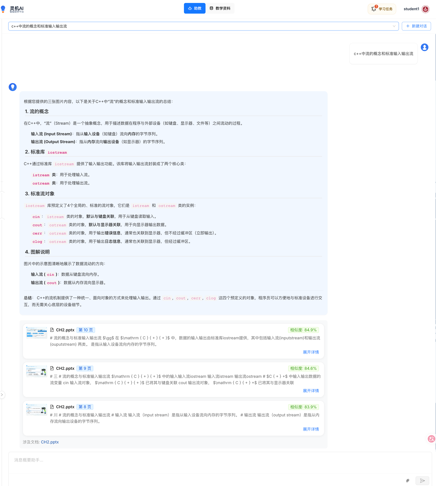
      <p align="center"><b>Workflow 检索模式</b><br/>固定流程检索，直接返回页面，用户可以看到具体的页面内容</p>
    </td>
    <td width="50%">
      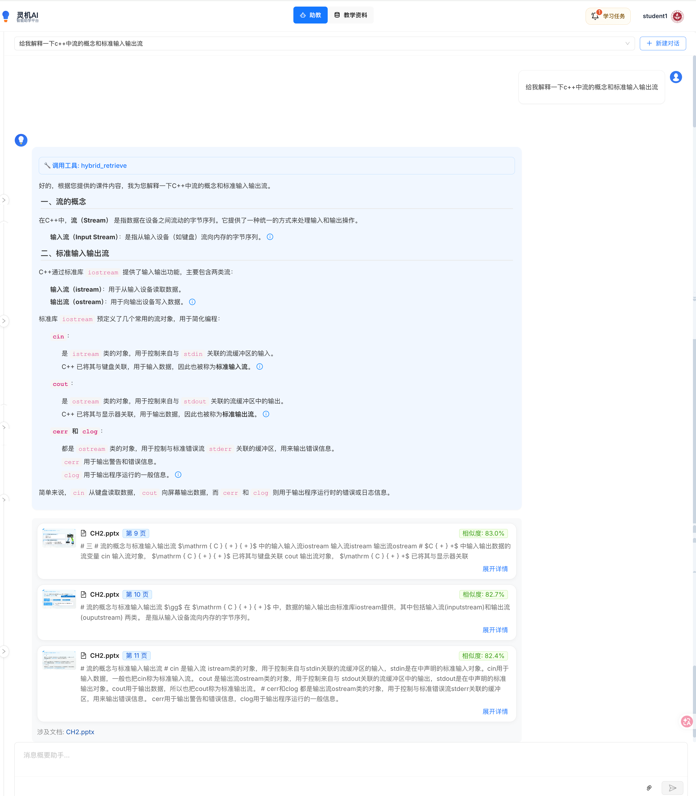
      <p align="center"><b>Agentic 智能模式</b><br/>基于 MCP 工具 + ReAct，AI 智能理解页面内容后生成答案，同时展示来源页面</p>
    </td>
  </tr>
  <tr>
    <td colspan="2" align="center">
      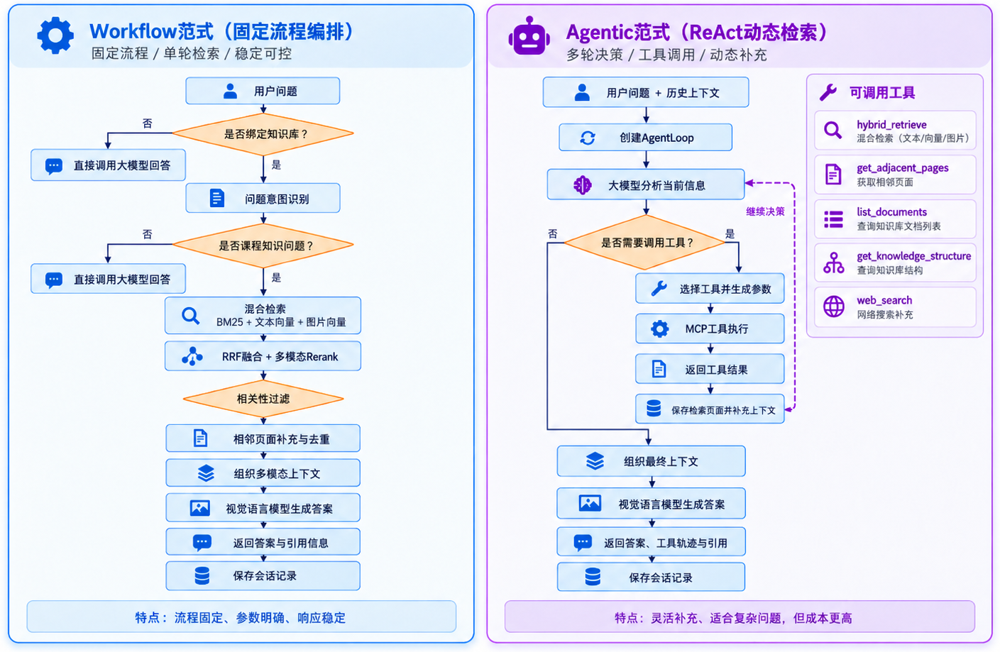
      <p><b>Workflow vs Agentic 对比</b><br/>
      📄 Workflow：快速定位页面，适合查找具体内容<br/>
      🤖 Agentic：智能推理决策，适合需要解释和归纳的复杂问题</p>
    </td>
  </tr>
</table>

**核心优势：**
- ✅ **可追溯性**：每个答案都能追溯到具体页面，避免 AI 幻觉
- ✅ **可验证性**：用户可以直接查看原文，验证 AI 回答的准确性
- ✅ **图文并茂**：保留原始页面的图表、公式、排版，完整呈现信息
- ✅ **多模态理解**：VLM 可以直接理解页面中的图片、表格、公式

**技术实现：**
- Workflow：基于预定义检索流程
- Agentic：集成 MCP (Model Context Protocol) 工具，通过 ReAct (Reasoning + Acting) 机制实现智能决策

---

### 🎓 学生端学习功能

<table>
  <tr>
    <td width="50%">
      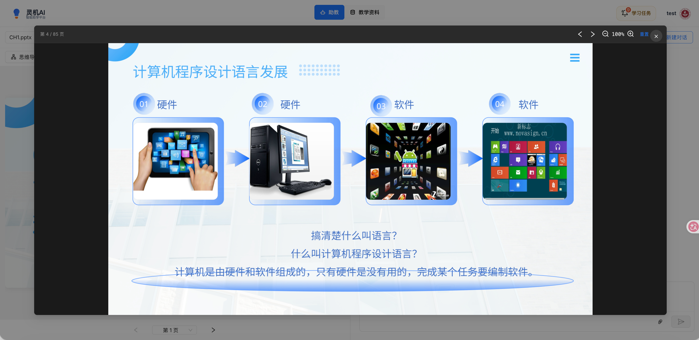
      <p align="center"><b>课件在线浏览</b><br/>支持 PDF、PPT 在线浏览，保留原始排版</p>
    </td>
    <td width="50%">
      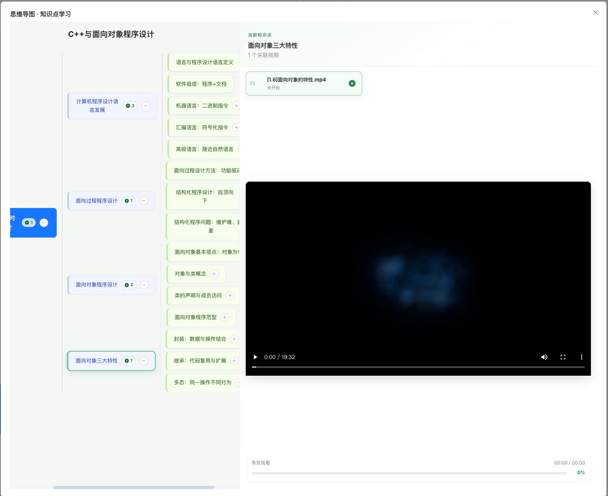
      <p align="center"><b>自动生成思维导图</b><br/>基于课件内容自动生成结构化思维导图</p>
    </td>
  </tr>
  <tr>
    <td width="50%">
      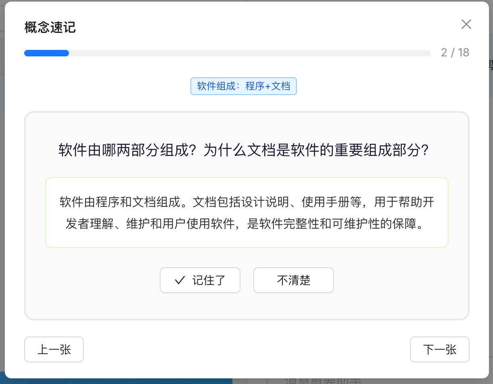
      <p align="center"><b>概念速记</b><br/>提取关键知识点，快速复习</p>
    </td>
    <td width="50%">
      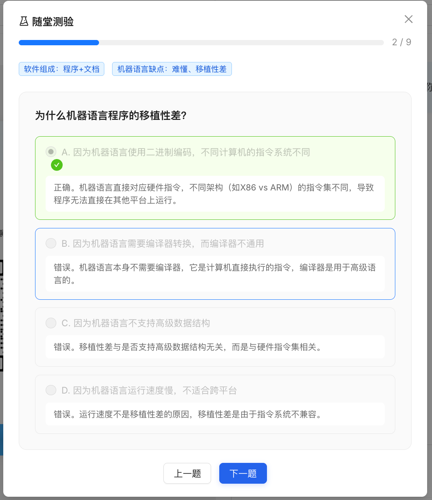
      <p align="center"><b>随堂测验</b><br/>自动生成测验题，巩固学习效果</p>
    </td>
  </tr>
</table>

---

### 💬 AI 对话与多模态理解

<table>
  <tr>
    <td width="50%">
      
      <p align="center"><b>AI 助教对话</b><br/>多轮智能问答，支持上下文理解</p>
    </td>
    <td width="50%">
      
      <p align="center"><b>智能问答界面</b><br/>清晰的问答交互设计</p>
    </td>
  </tr>
  <tr>
    <td width="50%">
      
      <p align="center"><b>图片上传提问</b><br/>支持上传图片直接提问</p>
    </td>
    <td width="50%">
      
      <p align="center"><b>图文混合输出</b><br/>返回结果包含相关图片和文本</p>
    </td>
  </tr>
  <tr>
    <td colspan="2" align="center">
      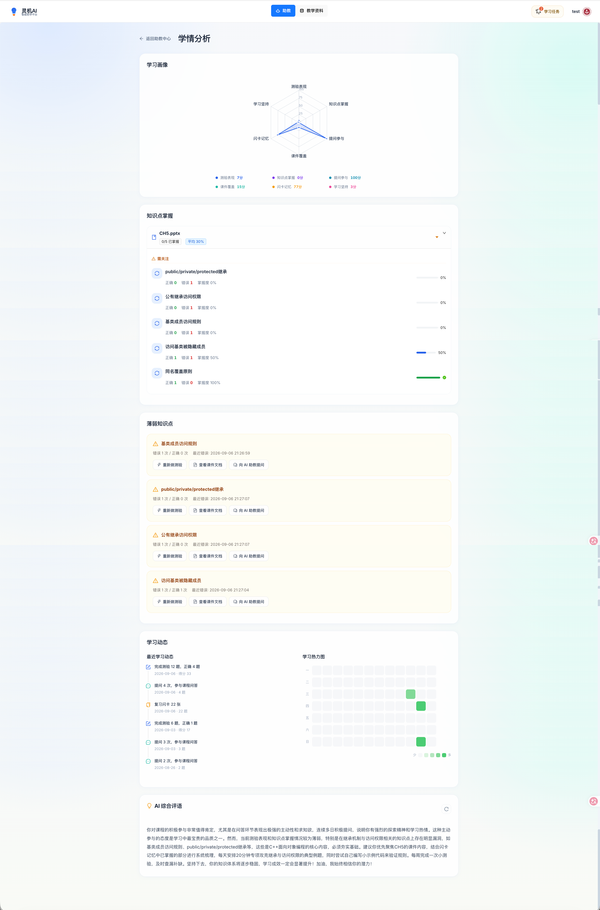
      <p><b>学生学情分析</b><br/>可视化展示学习进度、知识点掌握度、学习轨迹</p>
    </td>
  </tr>
</table>

---

### 👨‍🏫 教师管理后台

<table>
  <tr>
    <td width="50%">
      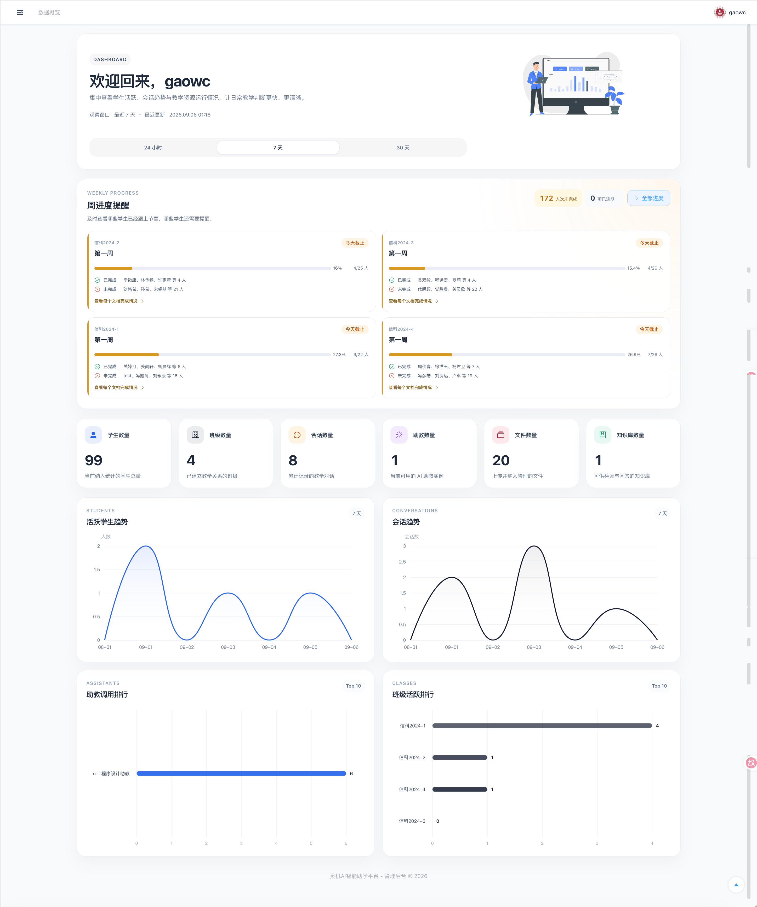
      <p align="center"><b>数据概览看板</b><br/>班级整体学习情况统计</p>
    </td>
    <td width="50%">
      
      <p align="center"><b>班级管理</b><br/>创建和管理教学班级</p>
    </td>
  </tr>
  <tr>
    <td width="50%">
      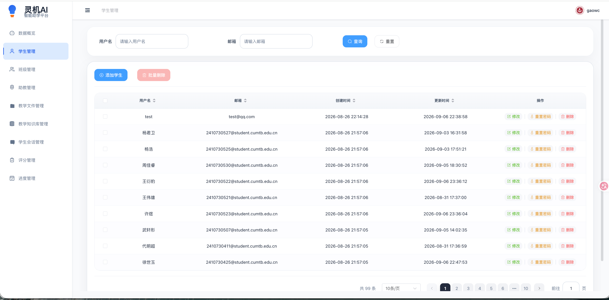
      <p align="center"><b>学生管理</b><br/>学生信息和权限管理</p>
    </td>
    <td width="50%">
      
      <p align="center"><b>助教配置</b><br/>自定义 AI 助教的知识库和模型</p>
    </td>
  </tr>
  <tr>
    <td width="50%">
      
      <p align="center"><b>知识库管理</b><br/>上传和管理教学资源</p>
    </td>
    <td width="50%">
      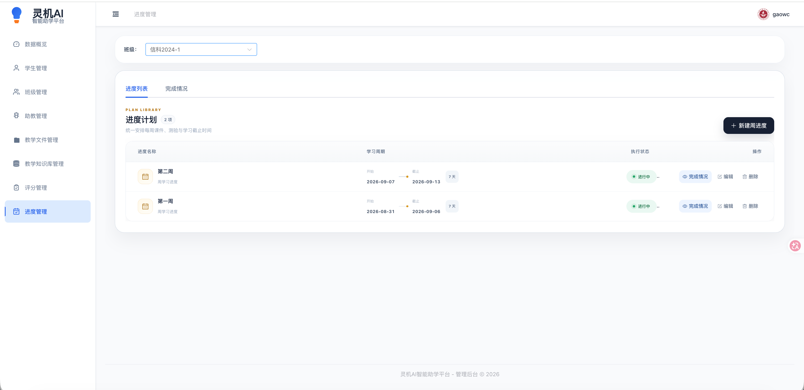
      <p align="center"><b>教学进度管理</b><br/>设置和追踪每周学习目标</p>
    </td>
  </tr>
  <tr>
    <td colspan="2" align="center">
      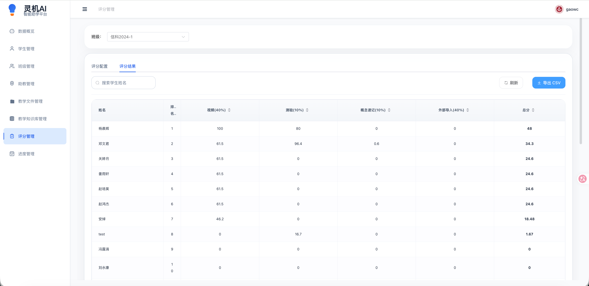
      <p><b>评分管理</b><br/>在线测验、作业评分与成绩统计</p>
    </td>
  </tr>
</table>

---

## 🏗️ 架构设计

### 系统首页与登录

<div align="center">
  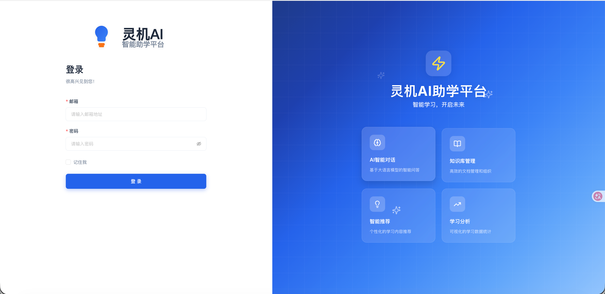
  <p><i>系统登录界面</i></p>
</div>

### 系统架构图

<div align="center">
  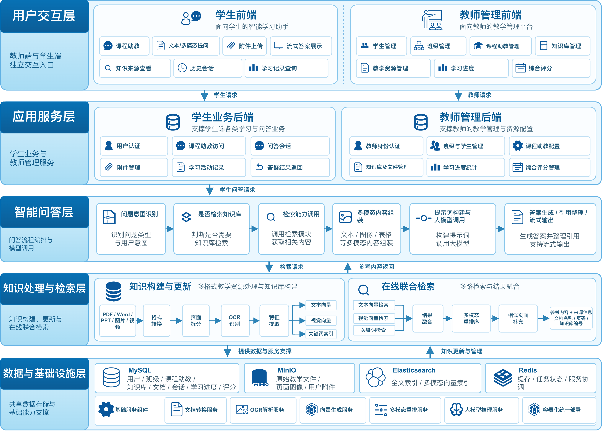
  <p><i>灵机多模态 RAG 系统架构</i></p>
</div>

### 检索与回答流程

<div align="center">
  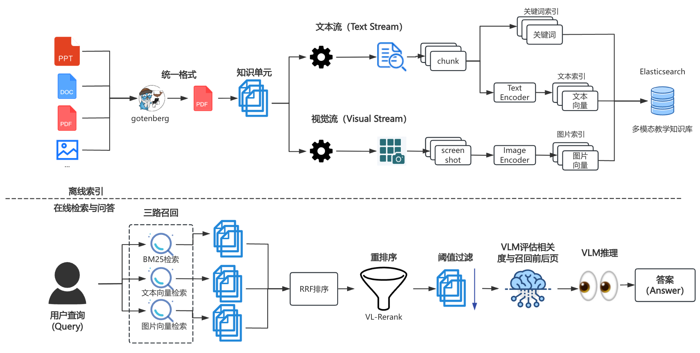
  <p><i>从文档上传到检索回答的完整业务流程</i></p>
</div>

### 角色权限关系

<div align="center">
  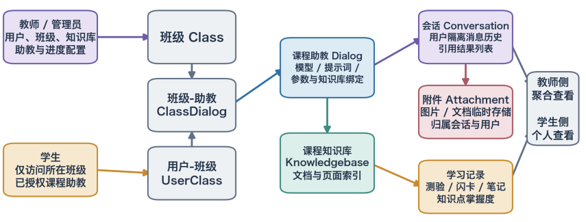
  <p><i>系统角色与权限设计</i></p>
</div>

### 技术架构

```
┌─────────────────────────────────────────────────────────────────┐
│  📱 前台系统 (学生 & 教师)                                        │
│  ┌────────────────────┐    ┌────────────────────────────────┐   │
│  │ Web (React + Umi)  │    │ API (Flask :9380)              │   │
│  │ - AI 对话答疑       │───▶│ - 对话管理 /v1/dialog/*         │   │
│  │ - 课件学习          │    │ - 知识库 /v1/kb/*               │   │
│  │ - 视频学习          │    │ - 文档解析 /v1/document/*       │   │
│  │ - 思维导图 & 闪卡   │    │ - 教学进度 /v1/progress/*       │   │
│  └────────────────────┘    └────────────────────────────────┘   │
├─────────────────────────────────────────────────────────────────┤
│  ⚙️ 后台管理系统 (教师专用)                                       │
│  ┌────────────────────────┐  ┌─────────────────────────────┐   │
│  │ Web (Vue3 + Element)   │  │ Management API (Flask :5000) │   │
│  │ - 学生 & 班级管理       │─▶│ - 用户管理 /api/v1/users/*   │   │
│  │ - 助教配置              │  │ - 班级管理 /api/v1/teams/*   │   │
│  │ - 教学文件管理          │  │ - 助教管理 /api/v1/assistants│   │
│  │ - 数据看板 (ECharts)    │  │ - 数据统计 /api/v1/dashboard │   │
│  └────────────────────────┘  └─────────────────────────────┘   │
├─────────────────────────────────────────────────────────────────┤
│  🧠 AI & 存储基础设施                                             │
│  ┌──────────────┐  ┌──────────────┐  ┌──────────────────────┐  │
│  │ Qwen3-VL     │  │ MinerU       │  │ MySQL + Redis        │  │
│  │ Embedding &  │  │ OCR Service  │  │ MinIO + Elasticsearch│  │
│  │ Reranker     │  │ :6060        │  │                      │  │
│  └──────────────┘  └──────────────┘  └──────────────────────┘  │
└─────────────────────────────────────────────────────────────────┘
```

---

## 🚀 快速开始

### 部署架构说明

Lingji 采用混合部署架构：
- **基础设施**：MySQL、Redis、Elasticsearch、MinIO 等通过 Docker Compose 启动
- **AI 服务**：Qwen3-VL、MinerU 微服务通过 Docker 启动
- **应用服务**：前台/后台的前端和后端需要独立启动（开发模式）

### 前置要求

- **Docker** 20.10+ 和 **Docker Compose** 2.0+
- **Python** 3.10-3.12（推荐使用 conda 管理环境）
- **Node.js** 16+（前端开发）
- **GPU**（推荐）：用于运行 Qwen3-VL 模型（至少 8GB 显存）
- **内存**：建议 16GB+

---

### 方案 A：完整部署（生产环境）

#### Step 1: 启动基础设施

```bash
# 1. 克隆仓库
git clone https://github.com/Freedom-s/lingji.git
cd lingji

# 2. 配置环境变量（重要！）
cp conf/service_conf.yaml.example conf/service_conf.yaml
# 编辑 conf/service_conf.yaml，配置数据库密码、API Key 等

cp docker/.env.example docker/.env
# 编辑 docker/.env，配置端口、时区等

# 3. 启动 Docker 基础设施（MySQL、Redis、ES、MinIO、AI 服务）
cd docker
docker compose up -d

# 4. 等待服务启动完成（约 3-5 分钟）
docker compose logs -f
```

#### Step 2: 启动应用服务

**方式 1：使用脚本启动（推荐）**

```bash
# 返回项目根目录
cd ..

# 构建并启动所有服务
./deploy.sh

# 服务将在后台运行：
# - 前台后端: http://localhost:9380
# - 前台前端: http://localhost:9222
# - 后台后端: http://localhost:5000
# - 后台前端: http://localhost:8888
```

**方式 2：手动启动各服务**

需要打开 **4 个终端窗口**，分别启动：

```bash
# Terminal 1: 前台后端 API (端口 9380)
conda create -n ragflowplus python=3.11
conda activate ragflowplus
pip install -r requirements.txt
python -m api.ragflow_server

# Terminal 2: 前台前端 (端口 9222)
cd web
npm install
npm run dev

# Terminal 3: 后台后端 (端口 5000)
cd management/server
conda activate ragflowplus  # 使用相同环境
python app.py

# Terminal 4: 后台前端 (端口 8888)
cd management/web
npm install
npm run dev
```

#### Step 3: 访问系统

| 系统 | 访问地址 | 默认账号 | 默认密码 |
|------|----------|----------|----------|
| **前台系统** | http://localhost:9222 | teacher1@qq.com | teacher1 |
| **后台管理** | http://localhost:8888 | teacher1@qq.com | teacher1 |

> ⚠️ **安全提示**：首次部署后请立即修改默认密码

---

### 方案 B：开发模式（推荐开发者使用）

详见 [`CLAUDE.md`](CLAUDE.md) 中的完整开发指南。

**快速启动开发环境：**

```bash
# 1. 启动基础设施
cd docker && docker compose up -d

# 2. 创建 Python 环境
conda create -n ragflowplus python=3.11
conda activate ragflowplus
pip install -r requirements.txt

# 3. 启动 4 个服务（每个在单独的终端）
# Terminal 1: 前台后端
python -m api.ragflow_server

# Terminal 2: 前台前端
cd web && npm run dev

# Terminal 3: 后台后端
cd management/server && python app.py

# Terminal 4: 后台前端
cd management/web && npm run dev
```

---

### 服务端口说明

| 服务 | 端口 | 说明 |
|------|------|------|
| **前台前端** | 9222 | React + Umi 4 |
| **前台后端** | 9380 | Flask API |
| **后台前端** | 8888 | Vue 3 + Element Plus |
| **后台后端** | 5000 | Flask Management API |
| **MySQL** | 5455 | 数据库 |
| **Redis** | 6379 | 缓存/队列 |
| **Elasticsearch** | 1200 | 全文检索 |
| **MinIO** | 9000 | 对象存储 |
| **Qwen3-VL Embedding** | 8000 | 嵌入模型服务 |
| **Qwen3-VL Reranker** | 8001 | 重排序模型服务 |
| **MinerU OCR** | 6060 | 文档解析服务 |

---

### 故障排查

**问题 1：Docker 服务启动失败**
```bash
# 查看服务日志
docker compose logs <service_name>

# 重启服务
docker compose restart <service_name>
```

**问题 2：前端无法访问后端**
- 检查 `conf/service_conf.yaml` 中的端口配置
- 确保防火墙允许相应端口

**问题 3：AI 模型加载失败**
- 检查 GPU 驱动是否正确安装
- 确认显存至少 8GB

**问题 4：数据库连接失败**
```bash
# 检查 MySQL 容器状态
docker compose ps mysql

# 重启 MySQL
docker compose restart mysql
```
## 📦 功能模块

### 👨‍🎓 学生端功能

| 模块 | 功能描述 |
|------|----------|
| **AI 助教对话** | 基于知识库的多轮智能问答，支持**页面级检索**和图文混合输出 |
| **Workflow 模式** | 固定流程检索，快速定位页面，直接展示原始内容 |
| **Agentic 模式** | MCP 工具 + ReAct 智能推理，适合复杂问题的理解和回答 |
| **课件学习** | 在线浏览 PPT/PDF，自动生成思维导图和概念速记 |
| **闪卡系统** | 知识点记忆卡片，支持自定义标签和复习计划 |
| **随堂测验** | 自动生成测验题，实时评估学习效果 |
| **视频学习** | 支持视频问答，自动提取视频字幕和关键帧 |
| **学习统计** | 个人学习时长、对话次数、知识点掌握度分析 |

### 👨‍🏫 教师端功能

| 模块 | 功能描述 |
|------|----------|
| **班级管理** | 创建班级、分配学生、管理教学进度 |
| **助教配置** | 自定义 AI 助教的知识库、模型、提示词、检索模式（Workflow/Agentic） |
| **教学文件管理** | 批量上传课件、视频，自动解析与索引 |
| **学生行为分析** | 查看学生学习轨迹、对话记录、知识点薄弱项 |
| **数据看板** | 班级整体学习情况、知识库使用热度、模型调用统计 |
| **成绩管理** | 导入/导出成绩，支持在线测验与自动评分 |
| **教学进度** | 设置每周学习目标，追踪完成情况 |

---

## 🛠️ 技术栈

### 核心框架

| 层级 | 技术选型 |
|------|----------|
| **前台前端** | React 18 + Umi 4 + Ant Design |
| **后台前端** | Vue 3 + Element Plus + ECharts |
| **后端 API** | Flask 3.0 + Peewee ORM |
| **管理后端** | Flask 3.0 + 原生 SQL |
| **任务队列** | Redis + Celery |

### AI & 数据处理

| 组件 | 说明 |
|------|------|
| **Qwen3-VL-Embedding-2B** | 多模态文本 + 图像嵌入向量生成 |
| **Qwen3-VL-Reranker-2B** | 检索结果重排序 |
| **MinerU** | 高精度 OCR 文档解析引擎 |
| **MCP (Model Context Protocol)** | Agentic 模式的工具调用协议 |
| **Elasticsearch** | 全文检索与向量检索 |
| **MinIO** | 对象存储（文件、图片、视频） |

### 数据库

- **MySQL 8.0**：存储用户、班级、对话、知识库等结构化数据
- **Redis 6.0**：缓存、会话管理、任务队列

---

## 🔧 开发指南

### 本地开发环境搭建

详见 [`CLAUDE.md`](CLAUDE.md) 中的开发命令部分。

需要启动 **4 个服务**：

```bash
# Terminal 1: 前台后端 API (端口 9380)
conda activate ragflowplus
python -m api.ragflow_server

# Terminal 2: 前台前端 (端口 9222)
cd web && npm run dev

# Terminal 3: 后台后端 (端口 5000)
cd management/server && python app.py

# Terminal 4: 后台前端 (端口 8888)
cd management/web && npm run dev
```

### 目录结构

```
lingji/
├── api/                    # 前台后端（Flask + Peewee）
│   ├── apps/              # 各功能模块的路由
│   └── db/                # 数据模型和服务层
├── web/                   # 前台前端（React + Umi）
├── management/            # 后台管理系统
│   ├── server/           # 后台后端（Flask + 原生 SQL）
│   └── web/              # 后台前端（Vue3 + Element Plus）
├── rag/                   # RAG 核心引擎
├── graphrag/              # 知识图谱 RAG
├── qwen3-vl-service/      # Qwen3-VL 推理服务
├── mineru-ocr-service/    # MinerU OCR 服务
├── docker/                # Docker 配置
├── pic/                   # 系统截图（23张）
│   ├── favicon.svg       # 项目 Logo
│   ├── student/          # 学生端截图（11张）
│   ├── teacher/          # 教师端截图（7张）
│   └── system/           # 架构图和流程图（5张）
└── docs/                  # 文档
```

---

## 🤝 贡献指南

欢迎提交 Issue 和 Pull Request！

1. Fork 本仓库
2. 创建特性分支：`git checkout -b feature/AmazingFeature`
3. 提交更改：`git commit -m 'Add some AmazingFeature'`
4. 推送到分支：`git push origin feature/AmazingFeature`
5. 提交 Pull Request

---

## 📜 许可证

本项目基于 **AGPL-3.0** 许可证开源。这意味着：

- ✅ **允许商用**：可用于 SaaS 和企业内部部署
- ✅ **允许修改**：可以自由修改源代码
- ⚠️ **必须开源**：若修改代码或通过网络提供服务，必须公开源码
- ⚠️ **相同许可**：衍生作品必须使用相同的 AGPL-3.0 许可证

详见 [`LICENSE`](LICENSE)。

---

## 🙏 致谢

本项目基于 [**ragflow-plus**](https://github.com/zstar1003/ragflow-plus) 进行深度定制开发，在此特别感谢原作者的开源贡献！

同时感谢以下开源项目：

- [ragflow-plus](https://github.com/zstar1003/ragflow-plus) - 本项目的直接基础，提供了完整的教学场景适配方案
- [RAGFlow](https://github.com/infiniflow/ragflow) - 强大的 RAG 引擎核心
- [MinerU](https://github.com/opendatalab/MinerU) - 高精度 OCR 文档解析引擎
- [Qwen-VL](https://github.com/QwenLM/Qwen-VL) - 多模态视觉语言模型
- [v3-admin-vite](https://github.com/un-pany/v3-admin-vite) - Vue3 后台管理模板

感谢所有开源贡献者！🎉

---

<div align="center">
  <p>如果这个项目对你有帮助，请给一个 ⭐️ Star 支持一下！</p>
  <p>Made with ❤️ by Lingji Team</p>
</div>
